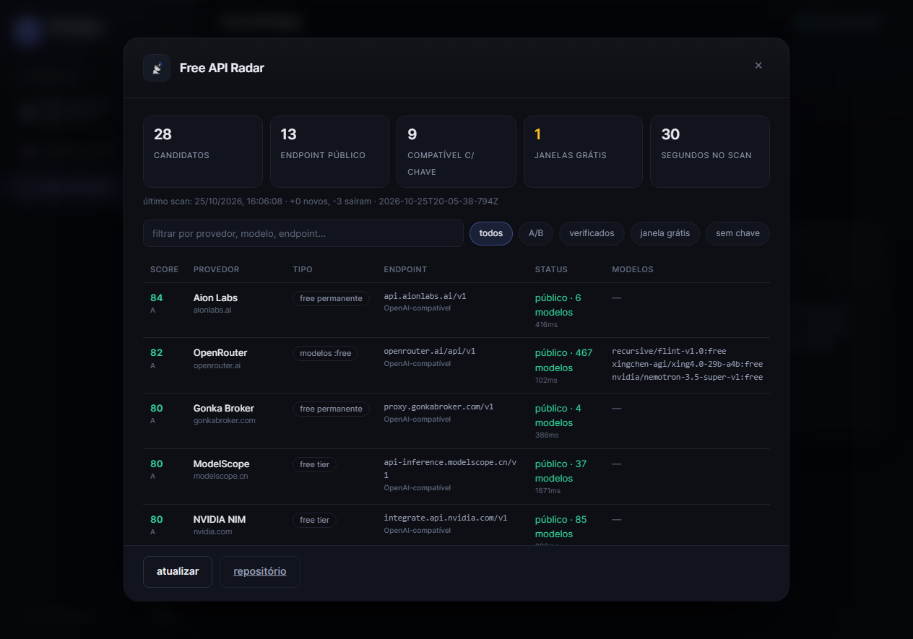

# Free API Radar

Descobre, extrai e **verifica ao vivo** serviços que oferecem acesso gratuito a modelos de LLM por API —
free tiers permanentes, modelos `:free`, créditos iniciais e "janelas grátis" temporárias como a do
[haimaker.ai/free](https://haimaker.ai/free) (que roda modelos de ponta de graça por alguns dias).

Não é mais uma lista estática: o valor está em (1) achar casos **novos** que ainda não estão nas listas,
(2) normalizar sinais de gratuidade muito diferentes e (3) **provar tecnicamente** que o endpoint responde.



## Por que não é só raspar o Google

Sites como haimaker não dizem "free" num lugar só: a gratuidade aparece como página `/free` com data de
término, como modelos `:free` num JSON de catálogo, como "free tier" no meio de um parágrafo, ou como
créditos de trial. O radar trata cada um desses formatos como **evidência citável** e depois testa o endpoint.
Uma lista de links não faz nada disso — e envelhece em dias.

## Pipeline

```
descoberta ──► extração ──► sondagem ──► verificação ──► score ──► relatório/dashboard ──► diff
```

| Etapa | O que faz | Fontes |
|---|---|---|
| **Descoberta** | acha candidatos que ainda não são conhecidos | busca em repositórios do GitHub, Hacker News, listas curadas (`awesome-free-llm-apis`), sementes de domínio |
| **Sondagem** | visita `/free`, `/pricing` e `/llms.txt` do host | detecta janela grátis, extrai ids de modelo e data de término |
| **Verificação** | `GET {api_base}/models` com timeout e retry educado | classifica: público / exige chave / sem listagem / fora do ar |
| **Score** | 0–100 com motivos auditáveis | tipo de free, endpoint vivo, compatibilidade OpenAI, nº de modelos, diversidade de fontes |
| **Saída** | `reports/radar.md`, `reports/dashboard.html`, `data/radar.sqlite`, `data/latest.json` | Markdown, dashboard sem CDN, SQLite |
| **Diff** | compara com a execução anterior | novos casos, casos que sumiram, mudança no nº de modelos |

## Uso

```bash
cd freeapi-radar
node cli.js scan                 # pipeline completo (~30-60s)
node cli.js scan --no-probe      # sem visitar /free e /pricing (mais rápido)
node cli.js list --verified      # só o que respondeu de fato
node cli.js list --window        # só janelas grátis ativas
node cli.js report               # regenera Markdown + dashboard a partir do banco
node cli.js export               # gera reports/litellm-radar.yaml
node cli.js diff                 # o que mudou desde o scan anterior
```

Prova de inferência real (opcional, com **sua** chave — nunca contorna autenticação):

```bash
RADAR_KEYS='{"groq.com":"gsk_...","cerebras.ai":"csk-..."}' node cli.js scan
```

Validação do dashboard (executa o JS embutido contra um DOM falso, sem navegador):

```bash
node test/smoke-dashboard.mjs
```

## Como ler o resultado

- **✓ público** — `GET /models` respondeu 200 sem chave: a superfície existe e é de fato aberta.
- **🔑 chave** — endpoint OpenAI-compatível que pede chave (401/403): o free tier costuma estar atrás disso.
- **· sem listagem** — o endpoint existe mas não expõe `/models` (ex.: Gemini); o score não penaliza.
- **Score A/B** — vale olhar; **C** — serve como reserva; **D** — ruído, ignore.

## Integrações

### Brodrigos Dashboard

A pasta `dashboard-tool/` é uma ferramenta do hub: o `scan` grava `latest.json` nela e o painel lê
direto. Basta apontar o `tools.json` do hub para a pasta:

```json
{ "paths": ["./tools", "../freeapi-radar/dashboard-tool"] }
```

O cartão aparece na home e abre um modal com estatísticas, filtros (A/B, verificados, janela grátis,
sem chave) e as evidências de cada caso. Sem servidor novo: o hub serve os arquivos em
`/tools/freeapi-radar/`.

### Alertas

O scan agendado roda com `--notify` e dispara quando (a) aparece uma **janela grátis**, (b) entra
candidato novo com score ≥ `--alert-min` (padrão 60) ou (c) muda a quantidade de modelos de um provedor.

Canais (o configurado que existir vence; sempre grava `reports/alerts.log`):

```bash
export TELEGRAM_BOT_TOKEN=123:ABC      # Telegram
export TELEGRAM_CHAT_ID=123456789
export RADAR_WEBHOOK_URL=https://...   # ou webhook genérico (Discord/Slack/n8n)
node cli.js alert-test                 # valida os canais
```

Para a tarefa agendada, prefira `config/alerts.json` (copie de `config/alerts.example.json`): variáveis
de ambiente podem não existir no contexto do Agendador de Tarefas.

### Gateway LiteLLM

`node cli.js export` escreve `reports/litellm-radar.yaml` com `model_list` pronto para o seu gateway,
só para endpoints compatíveis e verificados, com `api_key: os.environ/...`.

Para o que funciona **sem chave**, há um snippet pronto e um mesclador que não reformata o arquivo:

```bash
python scripts/merge-litellm.py --config /caminho/config.yaml --add scripts/litellm-keyless.yaml
python scripts/merge-litellm.py --config /caminho/config.yaml --add scripts/litellm-keyless.yaml --apply
```

Ele insere no fim do bloco `model_list:`, não sobrescreve modelo existente, valida com PyYAML (o arquivo
precisa parsear, crescer só o esperado e preservar todos os blocos anteriores) e faz backup
`config.yaml.bak-radar-<data>`. Depois é preciso reiniciar o container do LiteLLM.

### Agendar no Windows

```bash
scripts\install-schedule.cmd      # cria a tarefa "FreeApiRadar" a cada 6 horas
schtasks /Run /TN FreeApiRadar    # roda agora
```

O launcher `scripts/scan-task.cmd` chama `node cli.js scan --notify` e anexa em `reports/task.log`.

## Adicionar uma fonte nova

Crie uma função em `src/sources.js` que devolva candidatos no formato comum e registre-a em `collect()`:

```js
{
  key: 'exemplo.com',            // domainKey, usado para deduplicar
  name: 'Exemplo',
  homepage: 'https://exemplo.com',
  apiBase: 'https://api.exemplo.com/v1',   // opcional
  compat: true,
  models: ['org/modelo'],
  evidence: [{ source: 'minha-fonte', url: '...', kind: 'free-tier', quote: 'trecho citável' }]
}
```

O verificador e o score são genéricos: qualquer fonte que produza esse formato entra no radar.

## Limites e ética

- Só requisições GET/HEAD a páginas públicas, com `User-Agent` identificado, timeout e backoff.
- **Não** contorna autenticação, **não** coleta chaves de terceiros, **não** testa abuso de quota.
- Respeite os termos de cada provedor; "free" muda de regra sem aviso — o diff existe justamente para você notar.
- Lista de hosts ignorados (repositórios, blogs, hospedagem) fica em `BLOCKED_HOSTS`.
- Descoberta via GitHub/HN varia entre execuções (resultados mudam de dia para dia); o que vem de
  listas curadas e de sementes é estável. Use `diff` para separar novidade real de ruído de busca.

## Testes

```bash
node test/smoke-dashboard.mjs          # JS do dashboard contra um DOM falso
node test/verify-alerts.mjs            # canal webhook com receptor local
node test/verify-dashboard-tool.mjs    # abre a ferramenta no hub (Chrome headless/CDP)
```

`verify-dashboard-tool.mjs` precisa do hub rodando e do Chrome instalado; os outros dois não precisam de rede.

## Estrutura

```
cli.js                   comandos scan/list/report/export/diff/alert-test
src/sources.js           coletores + sondagem de /free, /pricing, llms.txt
src/verify.js            verificação passiva de endpoints
src/score.js             pontuação com motivos
src/store.js             SQLite + merge + diff histórico
src/report.js            Markdown + dashboard HTML autocontido
src/notify.js            alertas (Telegram, webhook, log)
src/litellm.js           export para model_list do gateway
src/text.js              parsers (awesome lists, JSON, HTML, sinais de free)
src/seeds.js             endpoints conhecidos, hosts bloqueados, fontes
dashboard-tool/          ferramenta do Brodrigos Dashboard (manifest + tool.js)
scripts/                 agendamento Windows e merge do LiteLLM
test/                    smoke do dashboard, alertas e ferramenta no hub
docs/                    screenshot
```
